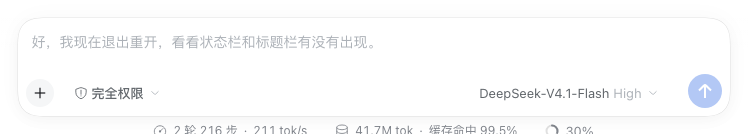

# dsh-followup-suggestion

[](https://github.com/619025226-lab/dsh-followup-suggestion/actions/workflows/ci.yml)
[](LICENSE)
[](https://github.com/619025226-lab/dsh-followup-suggestion/releases)

在 DeepSeek Harness 的输入框里，**每轮对话结束后自动出现一句根据刚才内容生成的「下一句」**。它显示为输入框里的灰色提示文字；输入框为空时按 **Enter** 就会采纳并直接发送，按 **Esc** 忽略，输入任意字符也会让它消失。

输入框里已经有文字时，工具栏会出现 **「✦ 润色」**：选风格、预览、替换草稿或撤销，只改草稿，不会发送。右键输入框或按 **Cmd/Ctrl+Shift+P** 也可以打开润色面板。



## 功能

- **下一句提示**：读取当前这一轮的用户消息、助手文字、工具调用和结束状态，生成可执行的后续指令。
- **本地优先**：先用零网络、零费用的启发式规则；Host 有默认模型时再异步润色。
- **草稿润色**：自然 / 简洁 / 专业 / 口语 / 自定义五种风格，先预览再替换，可撤销。
- **右键菜单**：输入框有文字时右键出现「润色这段草稿」。
- **目标完成抑制**：展示了最终交付文件或 goal 已完成后，默认不再显示「继续」提示，避免冗余。
- **不污染历史**：提示只改输入框 placeholder；润色只改草稿，不发送、不改已有消息。

## 环境要求

- DeepSeek Harness 0.2.x（desktop 或 web profile）
- Node.js 20+（仅 `install.sh`、构建和测试需要）
- 可选：当前 profile 有可用的默认模型；没有时下一句自动退回本地句，润色入口隐藏

## 安装

版本记录与安装说明：

- 最新版 **v0.3.1**：[v0.3.1 Release](https://github.com/619025226-lab/dsh-followup-suggestion/releases/tag/v0.3.1)
  完整地址：`https://github.com/619025226-lab/dsh-followup-suggestion/releases/tag/v0.3.1`
- 所有版本：[Releases](https://github.com/619025226-lab/dsh-followup-suggestion/releases)

Release 页也包含同一份安装说明。

```sh
git clone https://github.com/619025226-lab/dsh-followup-suggestion.git
cd dsh-followup-suggestion
./install.sh
```

`lib/client.js` 是已构建好的浏览器 bundle，直接安装即可。只有修改了 `lib/client.template.js` 或 `lib/suggest.js` 时才需要重新构建：

```sh
node build.mjs
./install.sh
```

安装脚本会：

1. 把插件复制到 `~/.dsh/plugins/dsh-followup-suggestion`；
2. 在 profile 的 `package.json` 里声明 `link:` 依赖，并建立 `node_modules` 符号链接；
3. 在 profile 的 `cordis.patch.yml` 中追加 `followup-suggestion` 的加载项，并固定 `suppressOnComplete: true`。

然后**完全退出并重新打开 DeepSeek Harness**。如果 Host 开着 HMR，通常刷新页面（Cmd+R）或等它自动重组即可；没有 HMR 时重启应用。

也可以用插件管理页 / `plugin_manager` 把本目录作为本地 bundle 安装（本包自带 `cordis.patch.yml`）。**两种方式二选一**，不要同时使用，否则同一个 row 会插入两次。

卸载：

```sh
./uninstall.sh
```

再重启应用。

## 使用

### 下一句提示

| 操作 | 结果 |
| --- | --- |
| 输入框为空时按 **Enter** | 采纳提示并发送（默认 `accept: send`） |
| 输入框为空时按 **Esc** | 忽略这一轮的提示，下一轮结束再出现 |
| 开始输入任意字符 | 提示自动隐藏，不会干扰正常草稿 |
| 流式运行 / 等待审批 / 有附件 / 已有草稿 | 不显示提示 |
| 切换会话 / 刷新页面 | 根据该会话最后一轮重新生成 |

提示只出现在**主会话**；子会话、空会话和已归档/移除的会话不显示。

### 草稿润色


> 截图中的对话内容已模糊处理。

1. 输入框有文字时，点工具栏「✦ 润色」、右键选「润色这段草稿」，或按 **Cmd/Ctrl+Shift+P**；
2. 选风格：**自然 / 简洁 / 专业 / 口语 / 自定义**；自定义可输入「更温柔」「像给同事发消息」「更学术」等要求；
3. 点「开始润色」，Host 调用默认模型，结果先进入预览；
4. 点「替换草稿」只替换输入框内容，**不会发送**；替换后可「撤销」，也可换风格「重新润色」。

润色只对**纯文本草稿**生效：带文件/会话引用、斜杠命令、空草稿或只有空白字符时不显示；带附件但文字正常的草稿仍可润色。

## 目标已达成时

以下任一信号出现时，如果这一轮没有新的问题、提议或明确下一步，默认**不显示**下一句提示：

- `deliverables/presented`（展示了最终交付文件）；
- `goal/change` 标记为完成。

想恢复「每轮结束都提示」，把 `suppressOnComplete` 设为 `false`。

## 配置

在 profile 的 `cordis.patch.yml` 里给 `followup-suggestion` 条目加 `config`：

```yaml
- id: followup-suggestion
  name: dsh-followup-suggestion
  config:
    mode: auto              # auto | heuristic | llm | off
    accept: send            # send：Enter 采纳并发送；fill：只填入草稿
    maxChars: 60            # 下一句提示最大字符数
    llmTimeoutMs: 6000      # 智能句超时，超时后保留本地句
    reasoningEffort: off    # 智能句/润色推理强度；默认 off
    polish: true            # 是否显示「润色」入口
    polishMaxChars: 4000    # 单次可润色的草稿上限
    polishTimeoutMs: 15000  # 润色超时
    suppressOnComplete: true # 目标已达成时抑制提示；false 则每轮都提示
    # provider: deepseek-account   # 可选，默认跟随当前默认模型
    # model: deepseek-flash        # 可选
```

- `auto`（默认）：先显示本地句，再异步用模型润色；
- `heuristic`：只用本地规则，不调用模型；
- `llm`：优先模型（失败仍回退本地规则）；
- `off`：关闭下一句提示；
- `accept: send` 一次 Enter 采纳并发送；`accept: fill` 只填入输入框；
- `polish: false` 只关闭草稿润色，不影响下一句提示。

## 隐私与数据

- 插件完全运行在本机；仓库和运行时都不保存 API Key、token 或凭据。
- 「下一句」的智能句只把最近一轮的简短文字/工具名发给**当前 profile 配置的模型**；不写磁盘、不上传第三方。
- 「润色」只把当前输入框草稿发给当前模型。
- 两者都不读取历史图片内容；提示和润色都不会自动发送消息。
- 不想产生模型调用：`mode: heuristic` + `polish: false`。

## 开发与测试

```sh
node build.mjs                 # 重新生成 lib/client.js
node --test test/*.test.mjs    # 23 个测试
```

CI 在 push / PR 时运行同一套构建、语法检查和测试：[.github/workflows/ci.yml](.github/workflows/ci.yml)。

项目结构：

```text
dsh-followup-suggestion/
  package.json           # dsh.client 声明 + 入口
  cordis.patch.yml       # 作为 bundle 使用时的加载项
  build.mjs              # 把 lib/suggest.js 内联进 lib/client.js
  lib/suggest.js         # 纯文本启发式：事件分析、主题/数量/提议/下一步提取
  lib/client.template.js # 浏览器半：事件订阅、placeholder、快捷键、润色面板
  lib/client.js          # 构建产物（真正被加载的 bundle）
  lib/index.js           # Host 半：/config、/suggest、/polish
  test/suggest.test.mjs  # 下一句启发式
  test/polish.test.mjs   # 润色输出清洗
  test/suppress.test.mjs # 交付文件 / goal 完成抑制
  install.sh / uninstall.sh
```

浏览器半没有额外 npm 依赖，只使用平台自带的 `react`。它把提示写进 composer 自带的 `[data-composer-placeholder]` 节点，因此位置、换行、省略号、输入法组合期间隐藏等行为与原生 placeholder 一致；润色面板挂到 `document.body` 的固定层，避免被 composer 的层叠上下文裁切。

## 排错

- **看不到下一句提示**：确认会话已经至少完成一轮；确认输入框为空；确认插件 row 已加载（设置 → 插件列表或插件管理页）。
- **目标完成后没有提示**：这是默认行为；把 `suppressOnComplete` 设为 `false` 可恢复每轮提示。
- **提示出现了但 Enter 没反应**：确认焦点在输入框内；确认没有按住 Shift/Cmd/Ctrl/Alt；确认输入法没有处于组合状态。
- **智能句一直是本地句**：Host `/suggest` 不可用，可能是 Host 半没加载、没有默认模型或模型调用失败；把 `mode` 设为 `heuristic` 可避免等待。
- **看不到「润色」按钮**：确认输入框里有纯文本且没有引用/斜杠命令；确认 `/config` 返回 `polish: true`、`capabilities.polish: true`；刷新页面。
- **润色失败**：检查默认模型是否可用，或调大 `polishTimeoutMs`；`/config` 里 `llm`/`polish` 为 `false` 时按钮不会出现。
- **撤销不可用**：撤销只在润色结果面板还开着时可用；关闭面板或继续输入后，草稿已是你确认过的内容。

## 限制

- 提示质量取决于最近一轮的文字和工具名；如果助手只调用了工具、没有文字，可能生成较通用的句子。
- 智能句和润色需要当前 profile 有可用的默认模型；没有时下一句退回本地句，润色入口隐藏。
- 只在 composer 为空时显示下一句提示；润色只处理纯文本草稿。
- 不读取、不上传历史中的图片内容。

## 更新记录

- **0.3.1**：目标已达成（展示交付文件 / goal 完成）且没有新问题或下一步时，默认不再显示「下一句」提示；`suppressOnComplete: false` 可恢复每轮提示。
- **0.3.0**：右键菜单加入「润色这段草稿」；风格增加「自定义」，可输入任意风格要求（如更温柔、像同事消息、更学术）。
- **0.2.0**：新增输入框草稿润色：工具栏「✦ 润色」、四种风格、预览、替换、撤销、Cmd/Ctrl+Shift+P 快捷键；Host 新增 `/polish`，与下一句建议相互独立。只处理纯文本草稿，不发送、不改历史消息。
- **0.1.1**：长请求不再把第一个分句硬截断成半句；图片/识别分支只读取用户自己的请求，避免把助手回答里的「截图 / 贴纸」示例误判成当前任务；Host 增加能力声明，旧 Host 没有推理控制时客户端只使用本地句，避免空回答；Host 模型调用固定 `reasoningEffort: off`，一句话生成更快更稳。

## 贡献与支持

欢迎提 issue / PR。个人项目，按 best effort 维护；涉及 UI 的改动请附截图，涉及宿主调用的改动请跑一遍 `node --test test/*.test.mjs`。

## License

[MIT](LICENSE)
